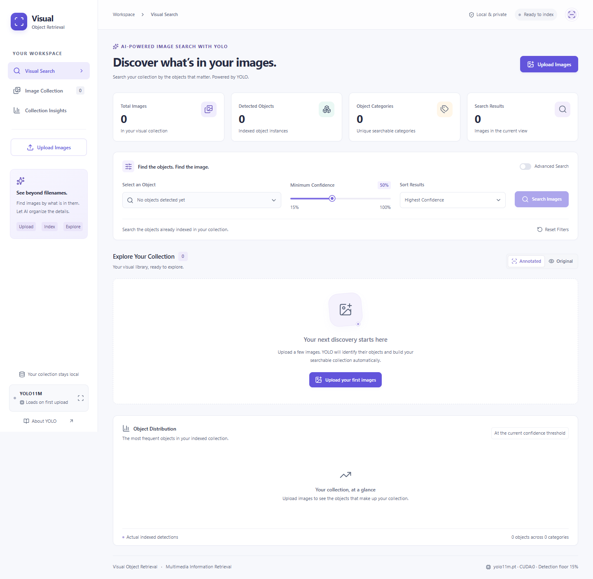
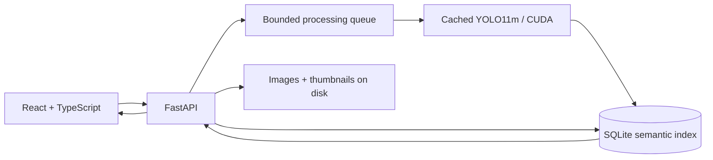

# Visual Object Retrieval

**AI-Powered Image Search with YOLO** — a local Multimedia Information Retrieval (MIR) application. Upload photographs, extract object metadata once with YOLO11, and retrieve images from a persistent semantic index. No cloud account or Docker installation is required.



## Features

- Batch JPG/JPEG/PNG/WEBP uploads, previews, processing progress, validation and duplicate detection.
- Cached YOLO11m, automatic CUDA selection, supported FP16, batch size 1, YOLO11s memory fallback and CPU recovery.
- Image files and thumbnails on disk; model provenance, bounding boxes and confidence metadata in SQLite.
- Actual collection category dropdown; single-object and multi-object AND/OR retrieval.
- Consistent confidence filtering, five deterministic sorts and paginated responsive galleries.
- Original/annotated detail viewer, deletion confirmations, collection statistics and object distribution chart.
- Automated tests and reproducible precision/recall evaluation using manual relevance labels.

## Architecture and stack



Frontend: React, TypeScript, Vite, Tailwind CSS, TanStack Query, Lucide React and Recharts. Backend: Python 3.11+, FastAPI, Uvicorn, Ultralytics, PyTorch, OpenCV, Pillow, NumPy, SQLAlchemy, SQLite and Pydantic. Tests: Pytest, Vitest and React Testing Library.

## Windows quick start

1. Install 64-bit [Python 3.11–3.14](https://www.python.org/downloads/windows/) and [Node.js](https://nodejs.org/en/download) 22.12+ within the 22.x line or 24+ (24 LTS recommended), with Python, Node.js and npm available on `PATH`. The scripts do not install these prerequisites.
2. Clone or download the repository, then double-click **`start.bat`**. You can also run `.\start.bat` from PowerShell. On the first run it creates `.venv`, installs backend dependencies, copies `.env.example` to `.env` if needed, installs frontend dependencies and builds the interface. It then starts the server in the background and opens [http://localhost:8000](http://localhost:8000).
3. Double-click **`stop.bat`**, or run `.\stop.bat`, to gracefully stop the instance started by the script. Your images, detections, settings and downloaded weights remain saved.

Later starts skip unchanged setup. After pulling source changes, stop and start the app to apply dependency updates and rebuild the interface when needed. Initial setup requires internet; model weights download on the first upload and are cached for later use.

For a new environment, the launcher installs PyTorch 2.11.0 and torchvision 0.26.0, choosing CUDA 12.8 wheels when NVIDIA hardware is available and CPU wheels otherwise. An existing PyTorch installation is retained. NVIDIA acceleration still requires a compatible driver; use the manual instructions below for a different PyTorch build.

Optional startup settings:

```powershell
.\start.bat -NoBrowser  # Start without opening a browser
.\start.bat -Port 8002  # Use http://localhost:8002
.\start.bat -Cpu        # Use CPU inference; install CPU wheels in a new environment
```

The scripts use `scripts/windows.ps1` to manage only their own app instance through a local control file. Server output is recorded in `data/launcher/server.stdout.log` and `data/launcher/server.stderr.log`. For a server started manually in a terminal, use Ctrl+C to stop it.

## Manual requirements and installation

Use Python 3.11–3.14 supported by your chosen PyTorch build (3.12 is a conservative choice; this workstation uses 3.14), Node.js 22.12+ or 24 LTS, and npm. NVIDIA acceleration requires a compatible driver. CPU inference is supported. Initial weight download requires internet; cached weights work offline.

Windows PowerShell, from the repository root:

```powershell
python -m venv .venv
.\.venv\Scripts\python.exe -m pip install --upgrade pip
# Tested combination for this RTX 4050 / driver 591.66 workstation:
.\.venv\Scripts\python.exe -m pip install torch==2.11.0 torchvision==0.26.0 --index-url https://download.pytorch.org/whl/cu128
.\.venv\Scripts\python.exe -m pip install -r backend/requirements-dev.txt
Copy-Item .env.example .env
cd frontend
npm ci
npm run build
cd ..
```

The CUDA command is the tested combination, not a universal GPU command. Select wheels compatible with your OS, Python, GPU and driver using the [official PyTorch installer](https://pytorch.org/get-started/locally/) and [version-specific commands](https://pytorch.org/get-started/previous-versions/). `nvidia-smi` displays driver CUDA capability; `torch.version.cuda` identifies the installed runtime. A separate CUDA toolkit is normally unnecessary for wheel-based inference.

For CPU-only Windows/Linux, replace the CUDA install command with:

```powershell
.\.venv\Scripts\python.exe -m pip install torch torchvision --index-url https://download.pytorch.org/whl/cpu
```

On macOS, use official macOS wheels (`python -m pip install torch torchvision`); available MPS acceleration uses FP32. AMD ROCm requires a supported OS/GPU combination; unsupported Windows GPUs fall back to CPU. On Linux/macOS use `python3 -m venv .venv`, `.venv/bin/python`, and `cp .env.example .env` in equivalent commands.

## Run locally

Serve the complete built application with one command:

```powershell
.\.venv\Scripts\python.exe scripts/run.py
```

Open **[http://localhost:8000](http://localhost:8000)**. FastAPI serves the React build and API together. Stop with Ctrl+C. Interactive API documentation: [http://localhost:8000/docs](http://localhost:8000/docs).

For frontend development, start the backend from the repository root:

```powershell
.\.venv\Scripts\python.exe -m uvicorn backend.app.main:app --host 127.0.0.1 --port 8000
```

In a second terminal:

```powershell
cd frontend
npm run dev
```

Open [http://localhost:5173](http://localhost:5173). Vite proxies `/api` to port 8000. Use one backend worker to retain one model and processing queue. Restart after backend changes; finish active uploads before restarting.

## GPU verification and model configuration

```powershell
nvidia-smi
.\.venv\Scripts\python.exe -c "import torch; print(torch.__version__); print(torch.version.cuda); print(torch.cuda.is_available())"
.\.venv\Scripts\python.exe scripts/hardware_probe.py --runs 5
```

The probe runs real inference and reports cold/warm timings. The default blank image verifies execution, not recognition accuracy. Pass `--image path/to/photo.jpg` for photographs. See [hardware measurements](docs/hardware-verification.md).

First inference downloads `yolo11m.pt` into `data/models/`. The model stays cached in memory, and weights persist on disk. A failed download produces an actionable job error; restore connectivity or place trusted official weights there and retry. Only load trusted weights.

Edit `.env` and restart to change settings:

| Variable | Default | Purpose |
| --- | --- | --- |
| `VOR_MODEL` | `yolo11m.pt` | Preferred detection model |
| `VOR_FALLBACK_MODEL` | `yolo11s.pt` | GPU memory fallback |
| `VOR_DEVICE` | `auto` | `auto`, `cpu`, `cuda:0`, supported `mps` |
| `VOR_IMAGE_SIZE` | `640` | Inference resize target |
| `VOR_DETECTION_CONFIDENCE` | `0.15` | Minimum confidence stored |
| `VOR_MAX_FILE_MB` | `20` | Maximum uploaded file size (MiB) |
| `VOR_MAX_IMAGE_PIXELS` | `40000000` | Maximum decoded pixels |
| `VOR_MAX_UPLOAD_FILES` | `50` | Files per request |
| `VOR_MAX_UPLOAD_BODY_MB` | `256` | Total multipart request limit (MiB) |
| `VOR_MAX_PENDING_IMAGES` | `250` | Queue capacity |
| `VOR_DATA_DIR` | `./data` | Database, images and weights |
| `VOR_THUMBNAIL_SIZE` | `640` | Maximum thumbnail edge |
| `VOR_CORS_ORIGINS` | Local Vite origins | JSON array of allowed origins |

FP16 is enabled only on supported CUDA hardware. Inference is serialized. A GPU memory failure unloads the model and retries YOLO11s; further GPU failure retries on CPU. The system endpoint and interface report active model/device, warnings and errors. Detection configuration changes affect newly indexed images; existing detections preserve their model provenance. Delete and reupload to reindex an entire collection with new settings.

## Usage

1. Select or drop images, inspect previews, and start upload/indexing.
2. Watch progress, duplicate counts and any processing errors.
3. Select a detected category or use advanced search for multiple categories.
4. AND requires every selected category in one image; OR accepts any selected category.
5. Adjust minimum confidence and sorting, search, and inspect matching bounding boxes.
6. Open details for metadata and original/annotated comparison.
7. Browse the complete collection, delete an image, or clear the collection with confirmation.

A photograph with no detections remains browsable. Categories come from actual detections. Search thresholds below the indexing floor cannot recover discarded detections.

## Indexing and retrieval algorithm

Uploads are checked by extension and decoded format, byte and pixel limits, then EXIF-normalized and stored with safe generated filenames. Normalized image files retain visual content without unnecessary embedded metadata. Thumbnails are generated once. SQLite stores uploaded-byte SHA-256, dimensions, timestamps, processing state, model and detections (class ID/name, confidence and pixel coordinates). Detection rows cascade on image deletion; files live on disk, not inside SQLite.

Retrieval joins images to detections, filters confidence and canonical category names, groups by image and requires the distinct matching category count for AND. OR accepts any matching class. Ranking uses the **highest matching detection confidence per image**. Empty category selection browses the collection. Stable image-ID tie-breakers make sorting deterministic. Categories, statistics, annotations and results use the active threshold. Searching never runs YOLO.

API routes cover health/system, upload jobs, image lists/details/files/thumbnails/detections, failed-image retry, category discovery, search, statistics and deletion. Explore typed schemas at `/docs`.

## Tests and retrieval evaluation

```powershell
.\.venv\Scripts\python.exe -m pytest -q
.\.venv\Scripts\python.exe -m ruff check backend scripts
.\.venv\Scripts\python.exe -m ruff format --check backend scripts
$env:VOR_RUN_INFERENCE_TEST='1'
.\.venv\Scripts\python.exe -m pytest backend/tests/test_detection.py -m inference -q
.\.venv\Scripts\python.exe -m pytest backend/tests/test_real_pipeline.py -m inference -q
Remove-Item Env:VOR_RUN_INFERENCE_TEST
cd frontend
npm test
npm run format:check
npm run build
# Browser workflow, using installed Edge and isolated data/browser-tests:
npx playwright test
```

The real-model smoke tests are opt in and need cached weights or download access. Other tests mock inference to check uploads, duplicates, indexing, persistence, thresholds, AND/OR, sorting, deletion, recovery and interface interactions. Production build includes TypeScript checking. Use Ruff and Prettier to retain consistent source formatting. See the [executed validation record](docs/validation.md).

The browser test starts its own backend on port 8001 and uses photographs included with the installed Ultralytics distribution. It skips when those assets are unavailable. Its test collection is isolated from your normal collection. Windows uses installed Microsoft Edge; other systems use Playwright Chromium (`npx playwright install chromium`). Set `VOR_BROWSER_CHANNEL=chromium` to use installed Playwright Chromium on Windows. The committed screenshots show an empty collection; sample photographs and browser traces remain excluded from Git.

Prepare 30–50 appropriately licensed photographs using the [demo guide](docs/demo-dataset.md). Independently label relevance and run `scripts/evaluate.py` using the [evaluation procedure](docs/evaluation.md). It reports true positives, false positives, false negatives, precision, recall and F1. No accuracy numbers are fabricated.

## Academic explanation

**What is YOLO?** YOLO (You Only Look Once) identifies object categories and localizes them using bounding boxes.

**Why use it?** It automatically extracts searchable semantic metadata. These pretrained YOLO11 weights recognize 80 COCO categories, not arbitrary objects. See [official YOLO11 documentation](https://docs.ultralytics.com/models/yolo11/).

**How are images indexed?** Each upload is processed once; detected classes, confidence and locations are stored with image metadata in SQLite.

**How does searching work?** User-selected categories and confidence become database filters. Matching images are ranked and displayed with boxes, without rerunning detection.

**Why MIR?** Visual feature extraction, persistent indexing, query filtering, ranking and relevance evaluation form a complete multimedia retrieval pipeline.

## Limitations and future improvements

COCO categories, occlusion, lighting, small objects and domain shifts limit recognition. Missed detections can cause missed relevant images. Confidence is a model score, not a calibrated relevance probability. The default maximum is 300 detections per image. SHA-256 detects byte-identical duplicates, not visually similar files. This is a local single-user application with one inference worker. There is no vector similarity, free-form text search or custom training.

Future work: manual corrections, fine-tuning, perceptual deduplication, text/image embeddings, richer relevance judgments and larger collection evaluation.

## License

GNU AGPL-3.0; see [LICENSE](LICENSE). Ultralytics and its weights have applicable AGPL/enterprise terms; see [Ultralytics licensing](https://www.ultralytics.com/license). Photograph rights must be independently verified. User images, databases, weights and environments are excluded from Git.
